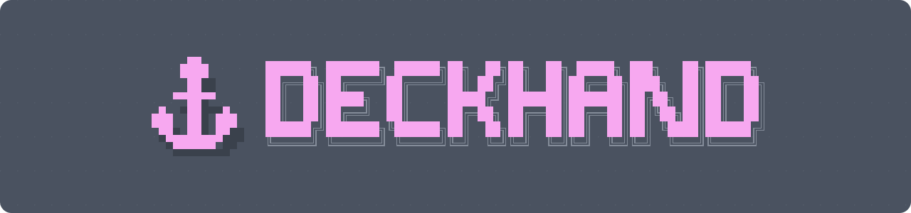

<h1 align="center"></h1>

<p align="center">
  <strong>A lightweight agent workbench for your IDE terminal.</strong><br>
  Claude Code, Codex and Pi side by side, each in its own git worktree.
</p>

<p align="center">
  <a href="https://github.com/tejgor/deckhand/releases"></a>
  <a href="https://github.com/tejgor/deckhand/actions/workflows/ci.yml"></a>
  <a href="LICENSE"></a>
</p>

https://github.com/user-attachments/assets/02462231-7c46-40bd-b523-be7153ff593e

> [!NOTE]
> Deckhand v3 is a rewrite in Rust: one native binary, no Node.js. It is still young, so behaviour and saved state can change between releases.

## Why Deckhand

Running several coding agents at once gets more done. By hand, it turns into three chores:

- **Keeping their work apart**: two agents in one checkout edit the same files. Deckhand starts each session in its own git worktree: a separate copy of the repository on its own branch. The worktree's shell, Git view, Dev command and notes come with it.
- **Knowing which one needs you**: one sidebar shows every session as working, idle or waiting for you, beside a live preview. You attach to an agent only when it needs you.
- **Landing the work and tidying up**: merging shows the commits and diff first, then stages the result for you to review. The Worktrees screen shows which worktrees are merged and what deleting each one would lose.

Deckhand lives in the terminal you already have open in your editor, so there is no separate app or window to keep track of.

## How it works

- A background **daemon** owns your sessions. Quit Deckhand and your agents keep running; run `deckhand` again and it reconnects.
- Each **session** runs one agent in its own terminal, usually in its own worktree. Agents keep their own conversations and approvals: you answer them in the agent's own screen.
- **Attach** (`o`) hands your terminal to a session; `ctrl+]` gives it back.

```text
deckhand (UI) ──▶ daemon ──▶ session worker ── agent              one per session
                         └─▶ workspace worker ── shell, lazygit, Dev   one per worktree
```

More in [docs/architecture.md](docs/architecture.md).

## Install

**Requirements**:

- macOS or Linux (x86_64 or aarch64). The Linux binaries need glibc 2.35 or newer.
- Windows: run Deckhand inside [WSL2](https://learn.microsoft.com/windows/wsl/install), using the Linux binary.
- `git`, and at least one agent on `PATH`: `claude`, `codex` or `pi`.
- Optional:
  - [`lazygit`](https://github.com/jesseduffield/lazygit) for `o` on the Git tab.
  - Cursor or VS Code for `E`, which opens a worktree, note or file in your editor. Other editors aren't supported.
  - [`gh`](https://cli.github.com), signed in, to open pull requests.
  - `npm` for the agent update check on the Agents screen (`U`).
  - On Linux, `notify-send` for desktop notifications.

**With the installer** (macOS and Linux; no Rust needed): it downloads the latest release's binary for your platform into `~/.local/bin` (`$XDG_BIN_HOME` when set) and adds that directory to your `PATH` if it isn't there yet:

```sh
curl --proto '=https' --tlsv1.2 -LsSf \
  https://github.com/tejgor/deckhand/releases/latest/download/deckhand-installer.sh \
  | sh
```

**From a release archive**: download the archive for your platform and `sha256.sum` from the [releases page](https://github.com/tejgor/deckhand/releases). In the folder you downloaded them to, check the archive and put the binary on your `PATH` (here `~/.local/bin`, which must be on your `PATH`):

```sh
TARGET=aarch64-apple-darwin       # or x86_64-apple-darwin, x86_64-unknown-linux-gnu, aarch64-unknown-linux-gnu
shasum -a 256 -c sha256.sum --ignore-missing
tar -xJf "deckhand-$TARGET.tar.xz"
mkdir -p ~/.local/bin && install -m 755 "deckhand-$TARGET/deckhand" ~/.local/bin/deckhand
```

If macOS refuses to open it, remove the download quarantine: `xattr -d com.apple.quarantine ~/.local/bin/deckhand`.

**With cargo** (Rust 1.88 or newer):

```sh
cargo install --git https://github.com/tejgor/deckhand deckhand
```

**Set up agents**: `deckhand setup` checks for Claude Code, Codex and Pi and offers to install the missing ones with their official installers. `deckhand setup --check` only reports.

### Updating

Install the new version the way you installed it: run the installer again, download the new archive, or add `--force` to the `cargo install` command. Then look at the **Daemon restart** line of the [release notes](https://github.com/tejgor/deckhand/releases):

- **Required**: the new version speaks another protocol, so `deckhand` refuses the running daemon until it restarts. Run `deckhand restart`.
- **Not required**: `deckhand` keeps working with the running daemon, which runs the previous version's daemon code until it restarts. Deckhand says so once, at the bottom of the screen (`Daemon 3.0.0 is still running (this is 3.0.1) · restart when convenient: deckhand restart`). Run `deckhand restart` when it suits you to pick up daemon fixes.

`deckhand restart` stops the daemon and starts the new version's. Running sessions are interrupted; `s` resumes each conversation. It asks first when sessions are running; `--yes` skips the question, and is needed when there is no terminal to ask on. `deckhand doctor` shows which version the running daemon is.

### Upgrading from v2 (npm)

Your sessions, notes and settings carry over: the files in `~/.deckhand` are unchanged.

1. Remove the npm install (`npm uninstall -g @tejgor/deckhand`) and install v3 as above. Check with `deckhand --version`.
2. Restart the daemon: `deckhand restart` stops the old one and starts v3's. This ends its running sessions; `s` resumes each conversation later.
3. If you use Codex with agent signals, regenerate its hooks: `deckhand doctor --check` tells you if they still call the old version.

[Upgrading from npm](docs/upgrading-from-npm.md) is the careful version, with a backup and a way back.

## Quick start

1. Run `deckhand` inside a git repository. The first run starts the background daemon. Your sessions are on the left (empty at first), and the selected session's tabs are on the right.
2. Press `n` for a new session. Pick an agent with `↑`/`↓` and press `enter`. Type a name: it becomes the session's title and, with a new worktree, the worktree's folder and branch name. Press `tab` until the form says **new worktree**, then `enter`.
3. The agent starts with no task. Press `o` to attach to it, type what you want done as you would in the agent itself, then press `ctrl+]` to detach. The agent keeps working.
4. Watch it on the Preview tab. With Claude Code, the sidebar shows `?` when the agent needs you, such as a question or a permission prompt: press `o` to answer it, then `ctrl+]` again. Codex shows `?` only once you set up its [agent signals](#configuration). Pi never does, so check its preview.
5. When the work is done, press `m` to merge its worktree into the branch of the checkout you started `deckhand` in. The result is staged, not committed.
6. Press `W` to see which worktrees are merged and safe to delete.

`q` quits Deckhand and leaves your agents running. `?` lists every key. To hand an agent its task without typing it, add the task to the task list (`b`, then `A`) and start a session from it with `n`: Deckhand types the task into the agent for you to send.

## Features

**Keep work apart**

- **Worktree sessions**: start an agent in a new worktree, an existing one or no worktree at all. [More](docs/features.md#sessions-and-sub-sessions)
- **Sub-sessions**: a clean agent in the parent's worktree, or a fork of the parent's conversation (`N`).
- **Shared worktree tabs**: sessions in one worktree share its shell, Git view and Dev command, which keep running after the agents exit. [More](docs/features.md#terminal-git-and-dev-panes)

**Know which one needs you**

- **Live previews**: watch any session without attaching to it.
- **Agent signals**: the sidebar shows when an agent is waiting for you, has finished or has failed, with optional desktop notifications. [More](docs/features.md#lifecycle-signals-and-notifications)
- **Resume anytime**: an exited session picks up its conversation where it stopped. Deckhand never quietly starts a blank one instead. [More](docs/features.md#agent-identity)

**Land the work and tidy up**

- **Merge from the sidebar**: preview the commits, then merge or squash-merge. The result is staged for review, and worktrees merged elsewhere (such as a merged PR) are marked too. [More](docs/features.md#merging-and-done)
- **Careful deletes**: Deckhand lists the uncommitted files and unmerged commits you would lose, and asks before deleting them. [More](docs/features.md#cleanup)
- **Worktrees screen** (`W`): every worktree of the repository, grouped by whether it is safe to delete. [More](docs/features.md#worktrees-w)

**Around the work**

- **Git tab**: the worktree's changes, with diffs and staging, like your editor's source control panel. [More](docs/features.md#git-changes)
- **Notes with checklists**: one Markdown note per worktree, editable in Deckhand, vim or VS Code. [More](docs/features.md#notes)
- **Tasks** (`b`): one task list per repository. Start a session from a task, and merging its worktree ticks it off. [More](docs/features.md#tasks)
- **Project settings**: a per-repository `deckhand.json` for defaults, a Dev command and named actions, reviewed before any of it runs. [More](docs/features.md#configuration)

## The sidebar

```text
│ Sessions         all 7/7 · ! 2 │   filter or search, and the count; ! 2 need you
│╎ 1 ▾ ⠋ auth refactor       ▶ ✶ │   ╎ shares the selected session's worktree
│› 2   ↳ ● write tests         π │   › selected
│╎ 3   ⑂ ○ try alt approach    ✶ │
│  4 ? fix flaky checkout e2e… ◇ │
│ ────────────────────────────── │
│ write tests                    │   the selected session, when there is room
│ π pi · idle · 7m               │
│ ⎇ feat/auth ╎2 ▶               │   branch; ╎2 two others share it, ▶ Dev runs
```

| Glyph | Meaning |
| --- | --- |
| `⠋` `●` `○` | working, idle, exited |
| `?` `◆` `!` | needs you, reply not read yet, failed |
| `↳` `⑂` | clean sub-session, forked sub-session |
| `▶` `✓` `☑` | Dev running, merged, done |
| `✶` `◇` `π` | Claude Code, Codex, Pi |

The full legend is in [docs/keys.md](docs/keys.md#sidebar).

## Essential keys

| Key | Action |
| --- | --- |
| `n` / `N` | New session / new sub-session |
| `j` / `k`, `1`–`9` | Move through the sessions / jump to one |
| `p` `t` `g` `d` `a` | Preview, Terminal, Git, Dev and Notes tabs |
| `→` / `←` | Step into the tab (scroll, browse changes, edit notes) / back out |
| `o` or `enter` | Attach to what the tab shows: the agent, the shell, lazygit or Dev |
| `ctrl+]` or `ctrl+space` | Detach and come back to Deckhand |
| `!` | Jump to the next session that needs you |
| `x` / `X` | Stop the session, asking first / force-stop it |
| `s` / `S` | Resume an exited session / restart it fresh |
| `m` | Merge the session's worktree into the current branch |
| `d` `d` | Start or stop the worktree's Dev command |
| `b` / `W` / `C` | Tasks / Worktrees / Settings |
| `?` | Every key, in the app |
| `q` | Quit; sessions keep running |

All keys, screen by screen: [docs/keys.md](docs/keys.md).

## Configuration

Press `C` for Settings: one column for your global settings and one for this repository. Global settings live in `~/.deckhand/config.json`. A repository's settings live in `deckhand.json` in its main checkout. They apply only once you trust that file's exact contents, and Deckhand asks before a new worktree, an action or the Dev command would use them. [More](docs/features.md#configuration)

**Agent signals** tell Deckhand when an agent needs you, has finished or has failed:

- **Unset** (the default): on for Claude Code, which needs nothing else.
- **On**: Claude Code and Codex. Codex needs its hooks, set up once: run `deckhand hooks codex`, merge the output into `$CODEX_HOME/hooks.json` (default `~/.codex`), then trust the hooks with `/hooks` in Codex. Deckhand never writes to the Codex home. [More](docs/features.md#lifecycle-signals-and-notifications)
- **Off**: neither.

Pi has no agent signals. Changing agent signals applies to sessions you start or restart afterwards, not to agents already running.

**Notifications** send the same as desktop alerts and are off by default. On macOS, switching them on sends a test notification so you can allow Deckhand straight away; if you missed it, see [allowing notifications on macOS](docs/features.md#allowing-notifications-on-macos).

## FAQ

**Does quitting Deckhand stop my agents?**
No. The daemon keeps them running. Stopping or restarting the daemon itself ends them; `s` resumes each conversation afterwards.

**Does Deckhand commit or push for me?**
Merges are staged, not committed. If the worktree has uncommitted files, the merge screen commits them first by default, with the session title as the message; press `space` there to leave them uncommitted in the worktree. Deckhand pushes only when you open a pull request from the Git summary (`i`, then `c`), after asking.

**Does it change my agents' settings?**
No. Claude Code gets Deckhand's hooks as a launch option, and you add Codex's hooks yourself.

**Which agents does it support?**
Claude Code, Codex and Pi.

**Does it run on Windows?**
Inside WSL2, with the Linux binary.

## Troubleshooting

- **Deckhand can't find an agent**: check with `which claude` (or `codex`, `pi`). Sessions start with the `PATH` of the shell that started the daemon: the one where you ran `deckhand` while no daemon was running, or `deckhand restart`. After installing an agent or changing `PATH`, run `deckhand restart` (which interrupts running sessions) from a shell that has the new `PATH`.
- **"protocol mismatch; a daemon restart is required"**: an older Deckhand's daemon is still running, usually just after upgrading. Run `deckhand restart`, then `deckhand` again. If that fails, stop it with `kill "$(cat ~/.deckhand/daemon.pid)"`.
- **"daemon … did not respond"**: see `~/.deckhand/daemon.log`, then `deckhand restart`.
- **Codex hooks warning about `cli.js hook`**: Codex still calls the old Node version. Run `deckhand hooks codex` and replace the stale entries in `$CODEX_HOME/hooks.json` (check `config.toml` too). `deckhand doctor --check` lists what is left.
- **`o` on the Git tab fails**: install [`lazygit`](https://github.com/jesseduffield/lazygit). The rest of the Git tab only needs `git`.
- **The Dev tab is empty**: press `d` twice quickly to start the Dev command, and set one in Settings (`C`). A single `d` only shows the tab.
- **No notifications on macOS**: allow Deckhand in System Settings › Notifications › Deckhand. If it isn't listed there, switch Notifications off and on in Settings (`C`) to send a test. [More](docs/features.md#allowing-notifications-on-macos)

## Development

```sh
git clone https://github.com/tejgor/deckhand.git
cd deckhand
cargo build -p deckhand                  # target/debug/deckhand
scripts/test.sh                         # build, then run all Rust tests (uses nextest when installed)
cargo clippy --workspace --all-targets -- -D warnings
cargo fmt --all --check
```

`scripts/deckhand-dev.sh --sandbox` runs this checkout's build against its own state in `~/.deckhand-dev`, beside your real Deckhand. See [docs/dev-build.md](docs/dev-build.md). Tests use temporary homes and fake agents; they never touch `~/.deckhand` or start a real agent. [Testing](docs/testing.md) describes behavior tests, snapshots, compatibility fixtures and focused runs.

Issues and pull requests are welcome: see [CONTRIBUTING.md](CONTRIBUTING.md). Report security issues privately, as [SECURITY.md](SECURITY.md) describes.

Related projects: [claude-squad](https://github.com/smtg-ai/claude-squad) and [agent-deck](https://github.com/asheshgoplani/agent-deck).

## Uninstall

Stop the daemon first, which ends any running sessions: `kill "$(cat ~/.deckhand/daemon.pid)"`. Then remove the binary:

```sh
cargo uninstall deckhand      # if installed with cargo
rm "$(command -v deckhand)"   # if installed with the installer or from a release archive
```

To remove all local state, delete `~/.deckhand`.

> [!WARNING]
> `~/.deckhand/worktrees/` holds git worktrees, which may contain uncommitted work. Remove them first, from the Worktrees screen (`W`) or with `git worktree remove`, so git's records stay consistent.

## Licence

Deckhand is released under the [MIT License](LICENSE).
