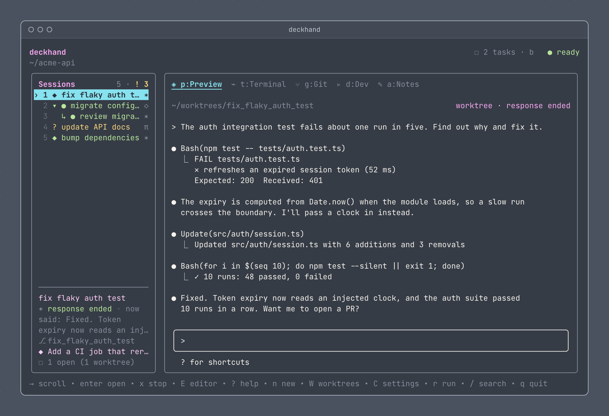

<h1 align="center"></h1>

<p align="center">
  <strong>Run Claude Code, Codex and Pi side by side, each in its own git worktree.</strong><br>
  A lightweight agent workbench for the terminal inside your editor.
</p>

<p align="center">
  <a href="https://github.com/tejgor/deckhand/releases"></a>
  <a href="https://github.com/tejgor/deckhand/actions/workflows/ci.yml"></a>
  <a href="LICENSE"></a>
</p>

<p align="center">
  <a href="#install">Install</a> ·
  <a href="#quick-start">Quick start</a> ·
  <a href="#features">Features</a> ·
  <a href="docs/keys.md">Keys</a> ·
  <a href="#documentation">Docs</a> ·
  <a href="#faq">FAQ</a>
</p>

https://github.com/user-attachments/assets/1cebcf63-9fed-4a9e-bbb1-283c77e789d6

> [!NOTE]
> Deckhand is a single native binary, written in Rust. It is still young, so behaviour and saved state can change between releases.

## Why Deckhand

Running several coding agents on one repository brings three chores. Deckhand takes care of each:

- **Keeping their work apart.** Two agents in one checkout edit the same files. Deckhand starts each session in its own git worktree: a separate checkout on its own branch, with its own shell, Git view, dev command and notes.
- **Knowing which one needs you.** One sidebar lists every session in sections: needs you, unread, working, idle and exited, beside a live preview. You attach to an agent only when it needs you.
- **Landing the work and tidying up.** Merging shows the commits and diff first, then stages the result for you to review. The Worktrees screen shows which worktrees are merged and what deleting each one would lose.

Deckhand lives in the terminal you already have open in your editor, so there is no separate app or window to keep track of. A background daemon keeps your agents running when you close it.

<p align="center"></p>

## Install

```sh
brew install tejgor/tap/deckhand
```

Or, without Homebrew:

```sh
curl -fsSL https://github.com/tejgor/deckhand/releases/latest/download/deckhand-installer.sh | sh
```

Deckhand runs on macOS and Linux, and on Windows inside WSL2. It needs `git` and at least one agent on your `PATH`: [Claude Code](https://code.claude.com) (`claude`), [Codex](https://github.com/openai/codex) (`codex`) or [Pi](https://pi.dev) (`pi`). `deckhand setup` installs any that are missing with their official installers.

Release archives, `cargo install`, optional tools, updating and uninstalling are in [docs/install.md](docs/install.md). Coming from Deckhand 2 on npm? See [Upgrading from npm](docs/upgrading-from-npm.md).

## Quick start

1. Run `deckhand` inside a git repository. The first run starts the background daemon.
2. Press `n` for a new session. Pick an agent with `↑`/`↓`, then type a name: it becomes the session's title and the new worktree's folder and branch. Press `tab` until the form says **new worktree**, then `enter`.
3. Press `o` to attach to the agent and give it a task, as you would in the agent itself. Press `ctrl+]` to detach; the agent keeps working.
4. Watch it on the Preview tab. When the agent needs you, such as a question or a permission prompt, the sidebar shows `?`: press `→` to answer it right there (or `o` to open it full screen), then `ctrl+]` to go back. Claude Code reports this out of the box and Codex after a [one-time setup](#configuration); with Pi, keep an eye on its preview.
5. When the work is done, press `m` to merge its worktree into the branch of the checkout you started `deckhand` in. The result is staged, not committed.
6. Press `W` to see which worktrees are merged and safe to delete.

`q` quits Deckhand and leaves your agents running. `?` lists every key.

## How it works

- A background **daemon** owns your sessions. Quit Deckhand and your agents keep running; run `deckhand` again and it reconnects.
- Each **session** runs one agent in its own terminal, usually in its own worktree. Agents keep their own conversations and approvals: you answer them in the agent's own screen.
- **Attach** (`o`) hands your terminal to a session; `ctrl+]` gives it back.

More in [docs/architecture.md](docs/architecture.md).

## Features

- **[Worktree sessions](docs/features.md#sessions-and-sub-sessions)**: start an agent in a new worktree, an existing one or none. Sub-sessions (`N`) add a clean agent in the parent's worktree or fork the parent's conversation.
- **[Shared worktree tabs](docs/features.md#terminal-git-and-dev-panes)**: sessions in one worktree share its shells, Git view and Dev command, which keep running after the agents exit.
- **[Agent signals](docs/features.md#lifecycle-signals-and-notifications)**: the sidebar shows when an agent is waiting for you, has finished or has failed, with optional desktop notifications.
- **[Resume](docs/features.md#resume-and-handoffs)**: `s` reopens an exited session's conversation where it stopped. Deckhand never quietly starts a blank one instead.
- **[Merge from the sidebar](docs/features.md#merging-and-done)**: preview the commits, then merge or squash-merge, staged for review. Worktrees merged elsewhere, such as through a pull request, are marked too.
- **[Careful deletes](docs/features.md#cleanup)**: Deckhand lists the uncommitted files and unmerged commits you would lose, and asks before deleting them.
- **[Git tab](docs/features.md#git-changes)**: the worktree's changes, with diffs and staging, like your editor's source control panel.
- **[Notes](docs/features.md#notes)**: one Markdown note with checklists per worktree, editable in Deckhand or your own editor.
- **[Tasks](docs/features.md#tasks)** (`b`): one task list per repository. Start a session from a task, and merging its worktree ticks it off.
- **[Project settings](docs/features.md#configuration)**: a per-repository `deckhand.json` for defaults, a Dev command and named actions, reviewed before any of it runs.

## Essential keys

| Key | Action |
| --- | --- |
| `n` / `N` | New session / new sub-session |
| `j` / `k`, `1`–`9` | Move through the sessions / jump to one |
| `p` `t` `g` `d` `a` | Preview, Terminal, Git, Dev and Notes tabs |
| `o` or `enter` | Attach to what the tab shows: the agent, the shell, lazygit or Dev |
| `ctrl+]` | Detach and come back to Deckhand |
| `!` | Jump to the next session that needs you |
| `s` / `S` `S` | Resume an exited session / restart it fresh (press twice) |
| `m` | Merge the session's worktree |
| `b` / `W` / `C` | Tasks / Worktrees / Settings |
| `?` | Every key, in the app |
| `q` | Quit; sessions keep running |

All keys, and what each sidebar symbol means: [docs/keys.md](docs/keys.md).

## Configuration

Press `C` for Settings: your global settings (`~/.deckhand/config.json`) in one column and this repository's (`deckhand.json` in its main checkout) in the other. Deckhand asks you to review a repository's `deckhand.json` before it runs anything from it, and again whenever it changes.

- **Agent signals** tell Deckhand when an agent needs you, has finished or has failed. Claude Code reports them out of the box. For Codex, switch agent signals on in Settings and set up its hooks once with `deckhand hooks codex` ([how](docs/features.md#lifecycle-signals-and-notifications)). Pi has no signals.
- **Notifications** (off by default) show the same signals as desktop alerts. On macOS, switching them on sends a test so you can allow Deckhand straight away ([details](docs/features.md#allowing-notifications-on-macos)).

## FAQ

**Does quitting Deckhand stop my agents?**
No. The daemon keeps them running. Stopping or restarting the daemon itself ends them; `s` resumes each conversation afterwards.

**Does Deckhand commit or push for me?**
It never commits on your branch: a merge leaves the result staged for you to commit. Before merging, it commits leftover changes in the agent's worktree, with the session title as the message; press `space` on the merge screen to leave them uncommitted. Deckhand pushes only when you open a pull request from the Git summary (`i`, then `c`), and asks first.

**Does it change my agents' settings?**
No. Claude Code gets Deckhand's hooks as a launch option, and you add Codex's hooks yourself.

**Something isn't working.**
See [Troubleshooting](docs/troubleshooting.md).

## Documentation

- [Installing, updating and uninstalling](docs/install.md)
- [Features](docs/features.md), in detail
- [Keys](docs/keys.md), screen by screen
- [Architecture](docs/architecture.md): processes, state and code layout
- [Troubleshooting](docs/troubleshooting.md)
- [Upgrading from Deckhand 2 (npm)](docs/upgrading-from-npm.md)

## Contributing

Issues and pull requests are welcome. [CONTRIBUTING.md](CONTRIBUTING.md) covers building from source, running a development build beside your real Deckhand, and the checks CI runs. Report security issues privately, as [SECURITY.md](SECURITY.md) describes.

## Licence

Deckhand is released under the [MIT License](LICENSE).
